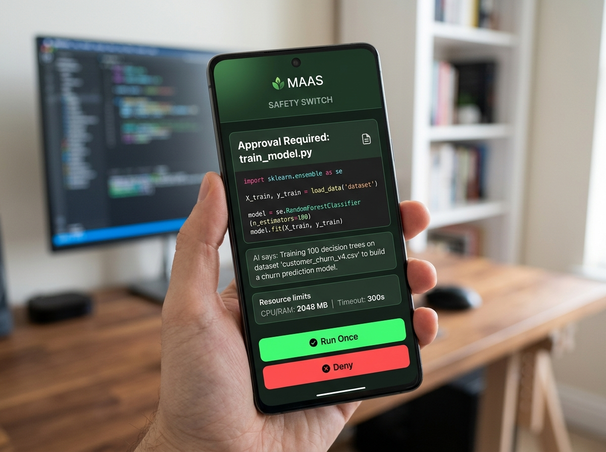

# MAAS — Make Anything Server

> **"AWS for Free" — Recycle any old, spare laptop into your own private AI compute server, with your phone as the remote safety switch.**

[](LICENSE)
[](src/)
[](https://modelcontextprotocol.io)
[](ollama_agent.py)
[](#)

---

## ⚡ The 30-Second TL;DR (Explain Like I'm 5)

> **"What if you had your own private AWS cloud in your bedroom that costs $0, never drains your battery, and lets you approve every line of AI code from your phone?"**

<p align="center">
  
</p>

1. **You have a main laptop** (like a MacBook Air or Windows work machine) where you code and chat with AI agents (Claude, Gemma, Cursor, ChatGPT).
2. **You have an old laptop** sitting in a drawer or closet that nobody uses.
3. **MAAS connects them over your home Wi-Fi in 60 seconds.**
4. When your AI writes heavy Python code, trains machine learning models, or crunches large datasets, **the old laptop does 100% of the hard work**.
5. **Your phone is the circuit breaker**: Before the AI runs any script or installs packages, your phone buzzes with a preview of the code and a **[Run]** or **[Deny]** button.

---

## 🥊 Why MAAS? (The Comparison)

| Factor | Running on Your Main Laptop | Renting Cloud (AWS / GCP / Modal) | 🚀 With MAAS (Our Project) |
|---|---|---|---|
| **Cost** | Free | **$30 – $100+ / month** (easy to forget and get billed) | **100% Free Forever** (recycles your existing hardware) |
| **Battery & Thermals** | Laptop gets boiling hot, battery dies in 40 mins | Saves battery, but requires Internet / Cloud access | **Main laptop stays cool & silent**; old laptop takes the heat |
| **Safety & Privacy** | **Dangerous**: AI hallucinations can delete local files | Private, but data leaves your local home network | **Air-gapped on your LAN**; no data leaves your home Wi-Fi |
| **Human Control** | Terminal popups that interrupt your active work | Opaque SSH logs with no physical kill-switch | **Physical Phone Safety Switch** with 1-tap Approve / Deny |
| **Can You Close the Lid?** | ❌ No. If you close your laptop, the AI job dies | Yes | **✅ Yes!** Close your Mac and sleep; the old laptop keeps computing |

---

## 📱 The Phone Safety Switch (Human-in-the-Loop)

<p align="center">
  
</p>

Whenever the AI agent (e.g. Claude Code or local Gemma 4) tries to execute code, install packages, or mutate files on the server:
- Execution **pauses automatically**.
- Your phone loads the **embedded MAAS Safety Dashboard** (works over local Wi-Fi with zero app installation).
- You inspect:
  - The **exact code** about to execute.
  - A **diff** highlighting changes from previous runs.
  - **"AI says: ..."** — the AI's natural language explanation of why it needs to run this.
  - Hardware limits: RAM cap, CPU timeout, and disk floor.
- Tap **[Run Once]**, **[Allow 10 Runs]**, or **[Deny]**.
- **Cryptographic guarantee:** The approved code is SHA-256 hashed. If a prompt-injection attack or race condition alters even a single character before execution, the node immediately halts.

---

## 🌟 Real-World Use Cases (Why This Wins Hackathons)

### 1. 🤖 24/7 Background AI Coding & Overnight Research
Tell your local Gemma or Claude agent: *"Run this genetic algorithm simulation for 500 generations."*
Normally, you cannot close your laptop or leave your desk. With MAAS, the compute job runs on the old laptop in the corner. You can shut your MacBook lid, put it in your backpack, or go to sleep—the job continues uninterrupted.

### 2. 📊 Heavy Machine Learning & Big-Data Crunching
Train Random Forest classifiers, run dense matrix multiplications, or ingest multi-gigabyte CSV/TSV datasets. MAAS features a custom streaming ingestion engine that converts gigabyte tables into indexed SQLite databases with constant memory, allowing low-RAM older machines to serve as high-performance data warehouses.

### 3. 🛡️ Sandboxing Untrusted Open-Source Code
Need an AI agent to clone a messy GitHub repository, install arbitrary dependencies, and run test suites? Running this on your main machine risks system dependency conflicts or malware. Running it on the MAAS node isolates the risk to a disposable sandbox with automatic memory watchdogs (`OOM_KILLED`) and execution timeouts.

### 4. ♻️ E-Waste Recycling & Democratizing AI Compute (Theme 2 Alignment)
Millions of laptops are discarded every year simply because their screens or batteries are degraded. MAAS breathes new life into this hardware, converting discarded machines into high-utility open-innovation compute nodes for students, hobbyists, and researchers who cannot afford expensive cloud bills.

---

## 📐 Complete System Architecture

```
                       ┌───────────────────────────────────────────────┐
                       │          Client Machine (Main Laptop)         │
                       │  • Local Ollama (Gemma 4) Agent (Python)      │
                       │  • Claude Code CLI                            │
                       │  • Cursor / Antigravity / Claude Desktop      │
                       └───────────────────────┬───────────────────────┘
                                               │
                                               │ Model Context Protocol
                                               │ (HTTP POST /mcp or Stdio Bridge)
                                               ▼
                       ┌───────────────────────────────────────────────┐
                       │           MAAS Node (Spare Computer)          │
                       │             Single C++17 Daemon               │
                       │                                               │
                       │   ┌───────────────────────────────────────┐   │
                       │   │ 16 MCP Tools (Execution, Data, Files) │   │
                       │   └───────────────────┬───────────────────┘   │
                       │                       │                       │
                       │            Hash-Bound Approval Check          │
                       │                       │                       │
                       │         ┌─────────────┴─────────────┐         │
                       │         ▼                           ▼         │
                       │   [ Tier 0 / 1 ]             [ Tier 2 ]       │
                       │   • Read hardware specs      • Execute script │
                       │   • Workspace files          • Pip install    │
                       │   • Read process logs        • Ingest dataset │
                       │         │                           │         │
                       │         ▼                           │ (Paused)│
                       │    (Immediate)                      ▼         │
                       │                             Waiting for Human │
                       └─────────────────────────────────────┬─────────┘
                                                             │
                                               Push Alert via│Local Wi-Fi
                                               LAN / QR Link │
                                                             ▼
                                               ┌───────────────────────┐
                                               │   Phone Safety Switch │
                                               │ • See exact bytes     │
                                               │ • See "AI says: ..."  │
                                               │ • Tap [Run] / [Deny]  │
                                               └───────────────────────┘
```

---

## 🛠️ The 16 Model Context Protocol (MCP) Tools

MAAS exposes 16 standardized tools accessible by any AI client conforming to Anthropic's Model Context Protocol (MCP):

| Category | Tool | Tier | Description |
|---|---|---|---|
| **System** | `get_node_capabilities` | Tier 0 | Probes hardware: CPU model, cores, AVX/AVX2 support, free RAM, disk, and discovered runtimes. |
| **Workspace** | `list_files` | Tier 1 | Lists files and directories in the sandboxed workspace. |
| **Workspace** | `read_file` | Tier 1 | Reads files safely from the workspace with path-traversal jail protection. |
| **Workspace** | `write_file` | Tier 1 | Writes code or data files into the node's workspace. |
| **Workspace** | `delete_file` | Tier 1 | Safely deletes files from the workspace. |
| **Workspace** | `patch_file` | Tier 1 | Applies unified diffs directly to files. |
| **Execution** | `execute_script` | **Tier 2** | **Executes Python, Node, Bash, or R scripts.** Sandboxed by memory limits, wall-clock timeout, and phone approval. |
| **Execution** | `get_task` | Tier 0 | Polls process state, exit codes, and structured failure categories. |
| **Execution** | `list_processes` | Tier 0 | Lists active and recent processes on the node. |
| **Execution** | `read_process_logs` | Tier 0 | Live-streams chunked process stdout/stderr logs (up to 8 KB per chunk). |
| **Execution** | `terminate_process` | Tier 0 | Instantly terminates a running process tree. Never requires approval. |
| **Packages** | `install_packages` | **Tier 2** | Installs Python (`pip`) or Node (`npm`) packages into MAAS's private prefix (not system root). |
| **Data Engine**| `ingest_dataset` | **Tier 2** | Streams large CSV/TSVs into SQLite with automatic encoding detection and column profiling. |
| **Data Engine**| `describe_dataset` | Tier 0 | Returns comprehensive dataset profile: row counts, column types, null counts, min/max values. |
| **Data Engine**| `list_datasets` | Tier 0 | Lists all ingested datasets and their table sizes. |
| **Data Engine**| `query_sql` | Tier 0 | Runs read-only, row-capped SQL queries (`SELECT`) directly against ingested datasets. |

---

## 🚀 60-Second Setup Guide

### 1. Start the Compute Node (On the Spare Laptop)

```bash
git clone https://github.com/devmayank729/MAAS.git maas
cd maas
sh install.sh
maas start
```

*The terminal will display your node's specs, its IP address, an ASCII QR code, and a client pairing code:*

```text
  MAAS node "maas-node" is running  v0.1.0
  Ubuntu 24.04.4 LTS, AMD Ryzen 3 5300U (8 threads, AVX2), 15305 MB RAM
  Address  http://10.80.18.195:7420

  1. Scan with your phone to approve jobs:
  [ QR Code ]
  http://10.80.18.195:7420/pair#k=wkqkmjthvc9x82x3

  2. Connect your AI client:
     curl -s -X POST http://10.80.18.195:7420/api/pair -H 'Content-Type: application/json' -d '{"code":"0585-3128"}'
```

### 2. Pair Your Phone

Scan the QR code with your phone camera (or open the URL in your phone browser). Keep the tab open to approve or deny jobs.

### 3. Connect Your AI Client on Your Main Laptop

#### Option A: Local Ollama (Gemma 4) Autonomous Agent
Talk to your locally running open-weight model:
```bash
python3 ollama_agent.py
```
*Gemma loads all 16 remote tools, writes code, dispatches jobs to the node, and awaits your phone approval.*

#### Option B: Standalone Live-Streaming CLI
Run scripts directly from your main laptop with live real-time output:
```bash
# Check remote specs:
python3 maas_cli.py specs

# Run a 4-minute compute benchmark with live streaming progress:
python3 maas_cli.py run heavy_workload.py -e "Compute stress test"
```

#### Option C: Claude Code CLI
```bash
# 1. Obtain token using the one-time code:
curl -s -X POST http://<NODE_IP>:7420/api/pair -H 'Content-Type: application/json' -d '{"code":"<CODE>"}'

# 2. Add MCP server:
claude mcp add --transport http --scope user maas-node http://<NODE_IP>:7420/mcp --header "Authorization: Bearer <TOKEN>"
```

#### Option D: Cursor / Claude Desktop / Antigravity IDE
Configure the stdio bridge in your `mcp_config.json`:
```json
{
  "mcpServers": {
    "maas-node": {
      "command": "/usr/bin/python3",
      "args": [
        "/path/to/maas/bridge.py",
        "http://<NODE_IP>:7420/mcp",
        "<YOUR_TOKEN>"
      ]
    }
  }
}
```

---

## 🔬 Self-Healing AI: Structured Failure Taxonomy

Unlike standard terminal executions that return unhelpful exit codes (like `1` or `137`), MAAS provides machine-readable diagnostic feedback so the AI can diagnose and repair its own code:

- `MODULE_NOT_FOUND`: Pinpoints the exact missing package and suggests candidate `pip` package names.
- `SYNTAX_ERROR`: Isolates the script file, line number, and offending character.
- `OOM_KILLED`: Warns that the job exceeded memory limits, prompting the AI to batch or stream data.
- `TIMEOUT`: Signals that execution hit the wall-clock limit, prompting the AI to optimize complexity.
- `ILLEGAL_INSTRUCTION`: Warns that compiled binaries or wheels used CPU vector instructions (e.g. AVX2) unsupported by older hardware.

---

## 📁 Repository Structure

```text
├── assets/                   # High-resolution diagrams & mobile UI mockups
│   ├── maas_architecture.jpg # 3-device system architecture diagram
│   └── maas_phone_ui.jpg     # Mobile safety switch interface mockup
├── src/
│   ├── main.cpp              # CLI entry point, signal handling & runtime discovery
│   ├── server.cpp            # HTTP server, routing & MCP JSON-RPC handler
│   ├── tools.cpp             # Implementation of all 16 MCP tools
│   ├── tasks.cpp             # Process sandbox, limits, execution wrappers & watchdog
│   ├── ingest.cpp            # Chunked CSV/TSV parser, type inference & SQLite streaming
│   ├── webpage.cpp           # Embedded HTML/CSS phone approval & control interface
│   ├── auth.cpp              # One-time codes, SHA-256 token hashing & role enforcement
│   ├── platform_posix.cpp    # POSIX process isolation, memory monitoring & terminal IO
│   ├── platform_win.cpp      # Windows compatibility layer
│   ├── runtimes.cpp          # Automated discovery of Python, Node, Bash, Rscript
│   ├── qr.cpp                # Terminal UTF-8 and ANSI QR code generator
│   └── db.cpp                # SQLite state persistence & WAL journal management
├── third_party/              # Vendored dependencies (cpp-httplib, nlohmann/json, sqlite3)
├── tests/
│   └── e2e.py                # 30-check automated integration test suite
├── heavy_workload.py         # 4-minute compute benchmark (Monte Carlo + SVD Matrix crunching)
├── train_iris.py             # Machine learning classification benchmark (Random Forest)
├── ollama_agent.py           # Fully local Ollama (Gemma 4) autonomous agent
├── maas_cli.py               # Live-streaming remote client CLI
├── bridge.py                 # Stdio-to-HTTP MCP protocol bridge
├── build.sh                  # Native C++ build script (optimised / debug)
└── install.sh                # Zero-dependency OS installer
```

---

## 📜 License

MAAS is open-source software licensed under the **[MIT License](LICENSE)**.  
Vendored libraries (`sqlite3`, `nlohmann/json`, `cpp-httplib`, `qrcodegen`) retain their respective open-source licenses.
